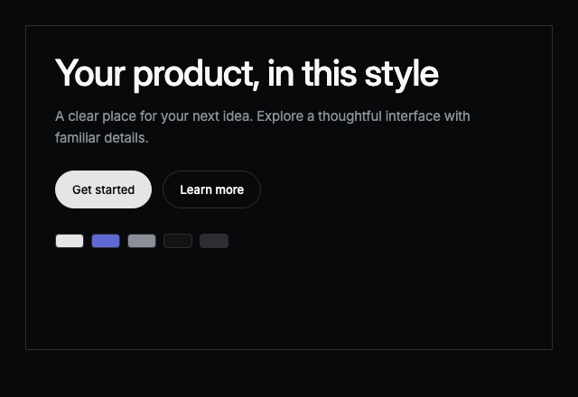
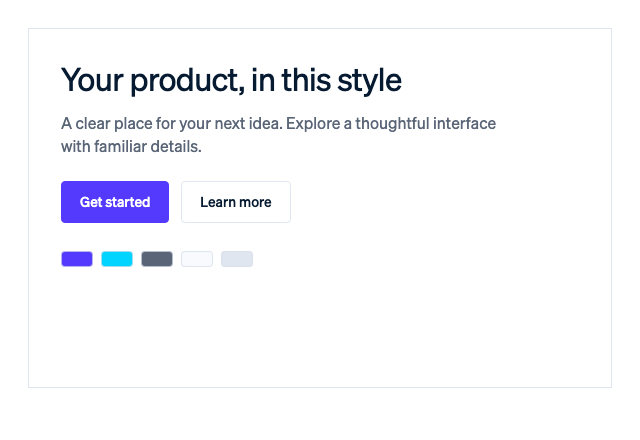
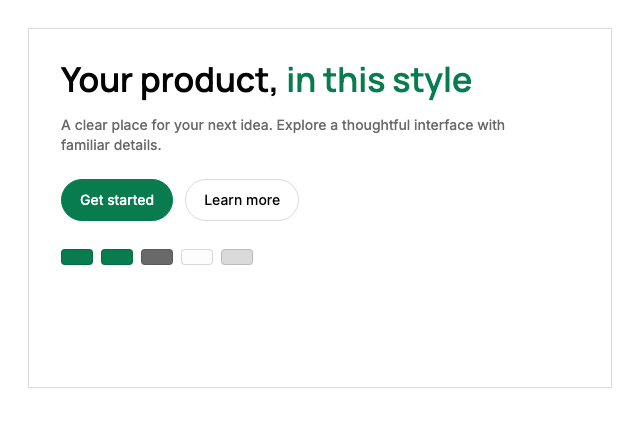
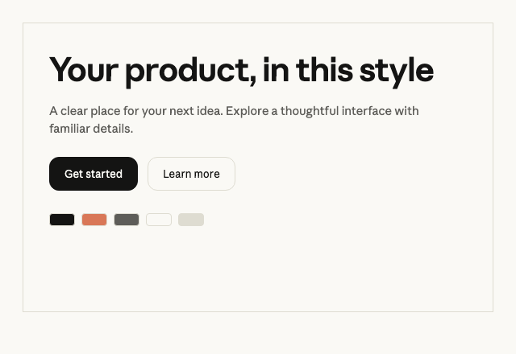
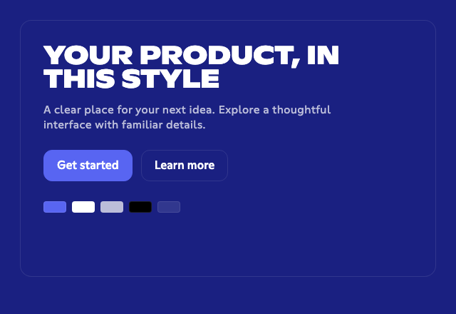
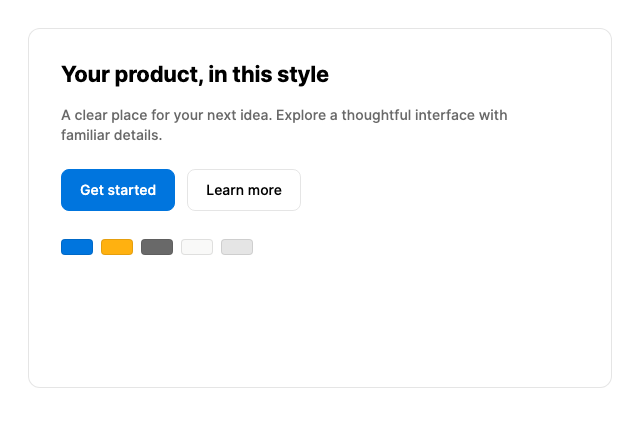
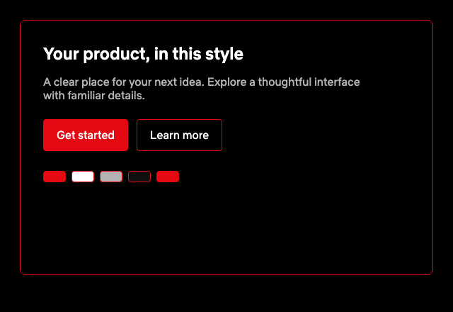
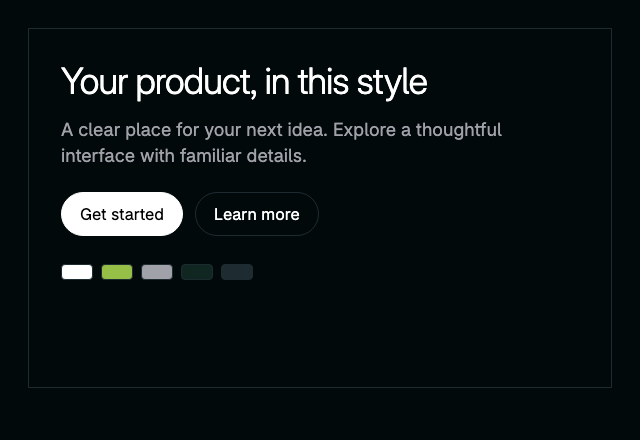

# DESIGN.md Gallery: 110 brands, measured from their rendered sites

Drop-in `DESIGN.md` files that every agent reads before visual work. Each holds a brand's colours, type, corner radii, spacing and component rules, measured from the brand's rendered public site and checked with Google's DESIGN.md linter. Each file names the pages and viewports it was measured from.

<table>
<tr>
<td align="center"><a href="linear/DESIGN.md"></a><br><sub>Linear</sub></td>
<td align="center"><a href="stripe/DESIGN.md"></a><br><sub>Stripe</sub></td>
<td align="center"><a href="supabase/DESIGN.md"></a><br><sub>Supabase</sub></td>
<td align="center"><a href="anthropic/DESIGN.md"></a><br><sub>Anthropic</sub></td>
</tr>
<tr>
<td align="center"><a href="discord/DESIGN.md"></a><br><sub>Discord</sub></td>
<td align="center"><a href="notion/DESIGN.md"></a><br><sub>Notion</sub></td>
<td align="center"><a href="netflix/DESIGN.md"></a><br><sub>Netflix</sub></td>
<td align="center"><a href="shopify/DESIGN.md"></a><br><sub>Shopify</sub></td>
</tr>
</table>

## Use a brand in one line

Paste this into any agent. Swap `linear` for any folder in the table below.

```text
Download https://briefatto.com/guides/linear-design-md/DESIGN.md and save it as DESIGN.md in the project root. Then run `npx briefatto-board install` and follow the Briefatto Board skill for all visual work in this project.
```

Or from a terminal:

```sh
curl -o DESIGN.md https://raw.githubusercontent.com/Briefatto/design-md-gallery/main/linear/DESIGN.md
npx briefatto-board install
```

## What every file carries

- **Tokens** in YAML front matter, to Google's DESIGN.md spec: colours, typography, radii, spacing and components.
- **Prose** an agent can act on: overview, colour roles, components, layout, voice, do's and don'ts.
- **Where it came from:** for example, "Built from / and /pricing, captured on 2026-11-21 UTC at 1440×900 and 390×844."
- **A preview** (`preview.png`) of the palette and type.

Each brand's guide on briefatto.com lists the page and viewport behind every colour and radius, and its Markdown version does the same for every spacing step. Every file drops into [Briefatto Board](https://github.com/Briefatto/briefatto-board), which versions the guide and checks every piece your agent renders.

Want your own brand instead? Run `npx briefatto-board adopt .` on your site and your agent writes yours.

## The files

| Brand | File | Guide | Source site |
| :--- | :--- | :--- | :--- |
| 10Web | [DESIGN.md](10web/DESIGN.md) | [Guide](https://briefatto.com/guides/10web-design-md/) | 10web.io |
| 1Password | [DESIGN.md](1password/DESIGN.md) | [Guide](https://briefatto.com/guides/1password-design-md/) | 1password.com |
| Abridge | [DESIGN.md](abridge/DESIGN.md) | [Guide](https://briefatto.com/guides/abridge-design-md/) | abridge.com |
| Ahrefs | [DESIGN.md](ahrefs/DESIGN.md) | [Guide](https://briefatto.com/guides/ahrefs-design-md/) | ahrefs.com |
| Airtable | [DESIGN.md](airtable/DESIGN.md) | [Guide](https://briefatto.com/guides/airtable-design-md/) | airtable.com |
| Algolia | [DESIGN.md](algolia/DESIGN.md) | [Guide](https://briefatto.com/guides/algolia-design-md/) | algolia.com |
| Amazon | [DESIGN.md](amazon/DESIGN.md) | [Guide](https://briefatto.com/guides/amazon-design-md/) | www.amazon.com |
| Animejs | [DESIGN.md](animejs/DESIGN.md) | [Guide](https://briefatto.com/guides/animejs-design-md/) | animejs.com |
| Annnimate | [DESIGN.md](annnimate/DESIGN.md) | [Guide](https://briefatto.com/guides/annnimate-design-md/) | annnimate.com |
| Ant Design | [DESIGN.md](ant-design/DESIGN.md) | [Guide](https://briefatto.com/guides/ant-design-design-md/) | ant.design |
| Anthropic | [DESIGN.md](anthropic/DESIGN.md) | [Guide](https://briefatto.com/guides/anthropic-design-md/) | anthropic.com |
| Appwrite | [DESIGN.md](appwrite/DESIGN.md) | [Guide](https://briefatto.com/guides/appwrite-design-md/) | appwrite.io |
| Asana | [DESIGN.md](asana/DESIGN.md) | [Guide](https://briefatto.com/guides/asana-design-md/) | asana.com |
| Astral | [DESIGN.md](astral/DESIGN.md) | [Guide](https://briefatto.com/guides/astral-design-md/) | astral.sh |
| Astro | [DESIGN.md](astro/DESIGN.md) | [Guide](https://briefatto.com/guides/astro-design-md/) | astro.build |
| Attio | [DESIGN.md](attio/DESIGN.md) | [Guide](https://briefatto.com/guides/attio-design-md/) | attio.com |
| Audi | [DESIGN.md](audi/DESIGN.md) | [Guide](https://briefatto.com/guides/audi-design-md/) | www.audi.com/en |
| Avenue | [DESIGN.md](avenue/DESIGN.md) | [Guide](https://briefatto.com/guides/avenue-design-md/) | avenue.app |
| Base44 | [DESIGN.md](base44/DESIGN.md) | [Guide](https://briefatto.com/guides/base44-design-md/) | base44.com |
| beehiiv | [DESIGN.md](beehiiv/DESIGN.md) | [Guide](https://briefatto.com/guides/beehiiv-design-md/) | www.beehiiv.com |
| Biome | [DESIGN.md](biome/DESIGN.md) | [Guide](https://briefatto.com/guides/biome-design-md/) | biomejs.dev |
| Bulma | [DESIGN.md](bulma/DESIGN.md) | [Guide](https://briefatto.com/guides/bulma-design-md/) | bulma.io |
| Bun | [DESIGN.md](bun/DESIGN.md) | [Guide](https://briefatto.com/guides/bun-design-md/) | bun.sh |
| Calendly | [DESIGN.md](calendly/DESIGN.md) | [Guide](https://briefatto.com/guides/calendly-design-md/) | calendly.com |
| Chromatic | [DESIGN.md](chromatic/DESIGN.md) | [Guide](https://briefatto.com/guides/chromatic-design-md/) | chromatic.com |
| Circle | [DESIGN.md](circle/DESIGN.md) | [Guide](https://briefatto.com/guides/circle-design-md/) | circle.so |
| Clay | [DESIGN.md](clay/DESIGN.md) | [Guide](https://briefatto.com/guides/clay-design-md/) | clay.com |
| Clerk | [DESIGN.md](clerk/DESIGN.md) | [Guide](https://briefatto.com/guides/clerk-design-md/) | clerk.com |
| ClickUp | [DESIGN.md](clickup/DESIGN.md) | [Guide](https://briefatto.com/guides/clickup-design-md/) | clickup.com |
| Cline | [DESIGN.md](cline/DESIGN.md) | [Guide](https://briefatto.com/guides/cline-design-md/) | cline.bot |
| Cloudflare | [DESIGN.md](cloudflare/DESIGN.md) | [Guide](https://briefatto.com/guides/cloudflare-design-md/) | www.cloudflare.com |
| Cohere | [DESIGN.md](cohere/DESIGN.md) | [Guide](https://briefatto.com/guides/cohere-design-md/) | cohere.com |
| Copilot | [DESIGN.md](copilot/DESIGN.md) | [Guide](https://briefatto.com/guides/copilot-design-md/) | copilot.app |
| Craft | [DESIGN.md](craft/DESIGN.md) | [Guide](https://briefatto.com/guides/craft-design-md/) | www.craft.do |
| CTS Network | [DESIGN.md](cts-network/DESIGN.md) | [Guide](https://briefatto.com/guides/cts-network-design-md/) | ctsnetwork.id |
| Datadog | [DESIGN.md](datadog/DESIGN.md) | [Guide](https://briefatto.com/guides/datadog-design-md/) | www.datadoghq.com |
| Deno | [DESIGN.md](deno/DESIGN.md) | [Guide](https://briefatto.com/guides/deno-design-md/) | deno.com |
| DevInsight | [DESIGN.md](devinsight/DESIGN.md) | [Guide](https://briefatto.com/guides/devinsight-design-md/) | devinsight.ai |
| Discord | [DESIGN.md](discord/DESIGN.md) | [Guide](https://briefatto.com/guides/discord-design-md/) | discord.com |
| Dribbble | [DESIGN.md](dribbble/DESIGN.md) | [Guide](https://briefatto.com/guides/dribbble-design-md/) | dribbble.com |
| Dropbox | [DESIGN.md](dropbox/DESIGN.md) | [Guide](https://briefatto.com/guides/dropbox-design-md/) | dropbox.com |
| Duolingo | [DESIGN.md](duolingo/DESIGN.md) | [Guide](https://briefatto.com/guides/duolingo-design-md/) | www.duolingo.com |
| ElevenLabs | [DESIGN.md](elevenlabs/DESIGN.md) | [Guide](https://briefatto.com/guides/elevenlabs-design-md/) | elevenlabs.io |
| Figma | [DESIGN.md](figma/DESIGN.md) | [Guide](https://briefatto.com/guides/figma-design-md/) | figma.com |
| Fin | [DESIGN.md](fin/DESIGN.md) | [Guide](https://briefatto.com/guides/fin-design-md/) | fin.ai |
| Firebase | [DESIGN.md](firebase/DESIGN.md) | [Guide](https://briefatto.com/guides/firebase-design-md/) | firebase.google.com |
| Firecrawl | [DESIGN.md](firecrawl/DESIGN.md) | [Guide](https://briefatto.com/guides/firecrawl-design-md/) | www.firecrawl.dev |
| Framer | [DESIGN.md](framer/DESIGN.md) | [Guide](https://briefatto.com/guides/framer-design-md/) | framer.com |
| Gemini CLI | [DESIGN.md](gemini-cli/DESIGN.md) | [Guide](https://briefatto.com/guides/gemini-cli-design-md/) | geminicli.com |
| Ghost | [DESIGN.md](ghost/DESIGN.md) | [Guide](https://briefatto.com/guides/ghost-design-md/) | ghost.org |
| GitHub | [DESIGN.md](github/DESIGN.md) | [Guide](https://briefatto.com/guides/github-design-md/) | github.com |
| Glean | [DESIGN.md](glean/DESIGN.md) | [Guide](https://briefatto.com/guides/glean-design-md/) | glean.com |
| Google | [DESIGN.md](google/DESIGN.md) | [Guide](https://briefatto.com/guides/google-design-md/) | about.google |
| Grammarly | [DESIGN.md](grammarly/DESIGN.md) | [Guide](https://briefatto.com/guides/grammarly-design-md/) | grammarly.com |
| Granola | [DESIGN.md](granola/DESIGN.md) | [Guide](https://briefatto.com/guides/granola-design-md/) | granola.ai |
| HeyGen | [DESIGN.md](heygen/DESIGN.md) | [Guide](https://briefatto.com/guides/heygen-design-md/) | heygen.com |
| HubSpot | [DESIGN.md](hubspot/DESIGN.md) | [Guide](https://briefatto.com/guides/hubspot-design-md/) | hubspot.com |
| Hugging Face | [DESIGN.md](hugging-face/DESIGN.md) | [Guide](https://briefatto.com/guides/hugging-face-design-md/) | huggingface.co |
| Hypergryph | [DESIGN.md](hypergryph/DESIGN.md) | [Guide](https://briefatto.com/guides/hypergryph-design-md/) | www.hypergryph.com |
| Intercom | [DESIGN.md](intercom/DESIGN.md) | [Guide](https://briefatto.com/guides/intercom-design-md/) | intercom.com |
| Jasper | [DESIGN.md](jasper/DESIGN.md) | [Guide](https://briefatto.com/guides/jasper-design-md/) | jasper.ai |
| Linear | [DESIGN.md](linear/DESIGN.md) | [Guide](https://briefatto.com/guides/linear-design-md/) | linear.app |
| Loom | [DESIGN.md](loom/DESIGN.md) | [Guide](https://briefatto.com/guides/loom-design-md/) | loom.com |
| Lovart | [DESIGN.md](lovart/DESIGN.md) | [Guide](https://briefatto.com/guides/lovart-design-md/) | www.lovart.ai |
| Mailchimp | [DESIGN.md](mailchimp/DESIGN.md) | [Guide](https://briefatto.com/guides/mailchimp-design-md/) | mailchimp.com |
| Mintlify | [DESIGN.md](mintlify/DESIGN.md) | [Guide](https://briefatto.com/guides/mintlify-design-md/) | mintlify.com |
| Miro | [DESIGN.md](miro/DESIGN.md) | [Guide](https://briefatto.com/guides/miro-design-md/) | miro.com |
| Mistral AI | [DESIGN.md](mistral-ai/DESIGN.md) | [Guide](https://briefatto.com/guides/mistral-ai-design-md/) | mistral.ai |
| Mixpanel | [DESIGN.md](mixpanel/DESIGN.md) | [Guide](https://briefatto.com/guides/mixpanel-design-md/) | mixpanel.com |
| Modal | [DESIGN.md](modal/DESIGN.md) | [Guide](https://briefatto.com/guides/modal-design-md/) | modal.com |
| Monday.com | [DESIGN.md](monday-com/DESIGN.md) | [Guide](https://briefatto.com/guides/monday-com-design-md/) | monday.com |
| NASA | [DESIGN.md](nasa/DESIGN.md) | [Guide](https://briefatto.com/guides/nasa-design-md/) | www.nasa.gov |
| Neon | [DESIGN.md](neon/DESIGN.md) | [Guide](https://briefatto.com/guides/neon-design-md/) | neon.com |
| Netflix | [DESIGN.md](netflix/DESIGN.md) | [Guide](https://briefatto.com/guides/netflix-design-md/) | www.netflix.com |
| Nothing | [DESIGN.md](nothing/DESIGN.md) | [Guide](https://briefatto.com/guides/nothing-design-md/) | nothing.tech |
| Notion | [DESIGN.md](notion/DESIGN.md) | [Guide](https://briefatto.com/guides/notion-design-md/) | notion.com |
| OpenClaw | [DESIGN.md](openclaw/DESIGN.md) | [Guide](https://briefatto.com/guides/openclaw-design-md/) | openclaw.ai |
| Otter.ai | [DESIGN.md](otter-ai/DESIGN.md) | [Guide](https://briefatto.com/guides/otter-ai-design-md/) | otter.ai |
| Palantir | [DESIGN.md](palantir/DESIGN.md) | [Guide](https://briefatto.com/guides/palantir-design-md/) | www.palantir.com |
| Perplexity | [DESIGN.md](perplexity/DESIGN.md) | [Guide](https://briefatto.com/guides/perplexity-design-md/) | www.perplexity.ai |
| Porsche | [DESIGN.md](porsche/DESIGN.md) | [Guide](https://briefatto.com/guides/porsche-design-md/) | www.porsche.com/usa |
| Prisma | [DESIGN.md](prisma/DESIGN.md) | [Guide](https://briefatto.com/guides/prisma-design-md/) | prisma.io |
| Proton | [DESIGN.md](proton/DESIGN.md) | [Guide](https://briefatto.com/guides/proton-design-md/) | proton.me |
| Railway | [DESIGN.md](railway/DESIGN.md) | [Guide](https://briefatto.com/guides/railway-design-md/) | railway.com |
| Ramp | [DESIGN.md](ramp/DESIGN.md) | [Guide](https://briefatto.com/guides/ramp-design-md/) | ramp.com |
| Resend | [DESIGN.md](resend/DESIGN.md) | [Guide](https://briefatto.com/guides/resend-design-md/) | resend.com |
| Runway | [DESIGN.md](runway/DESIGN.md) | [Guide](https://briefatto.com/guides/runway-design-md/) | runwayml.com |
| Samsung | [DESIGN.md](samsung/DESIGN.md) | [Guide](https://briefatto.com/guides/samsung-design-md/) | www.samsung.com/us |
| Sarvam AI | [DESIGN.md](sarvam-ai/DESIGN.md) | [Guide](https://briefatto.com/guides/sarvam-ai-design-md/) | www.sarvam.ai |
| Scale AI | [DESIGN.md](scale-ai/DESIGN.md) | [Guide](https://briefatto.com/guides/scale-ai-design-md/) | scale.com |
| Semrush | [DESIGN.md](semrush/DESIGN.md) | [Guide](https://briefatto.com/guides/semrush-design-md/) | www.semrush.com |
| Sentry | [DESIGN.md](sentry/DESIGN.md) | [Guide](https://briefatto.com/guides/sentry-design-md/) | sentry.io |
| Shopify | [DESIGN.md](shopify/DESIGN.md) | [Guide](https://briefatto.com/guides/shopify-design-md/) | shopify.com |
| Sierra | [DESIGN.md](sierra/DESIGN.md) | [Guide](https://briefatto.com/guides/sierra-design-md/) | sierra.ai |
| Slack | [DESIGN.md](slack/DESIGN.md) | [Guide](https://briefatto.com/guides/slack-design-md/) | slack.com |
| Stripe | [DESIGN.md](stripe/DESIGN.md) | [Guide](https://briefatto.com/guides/stripe-design-md/) | stripe.com |
| Supabase | [DESIGN.md](supabase/DESIGN.md) | [Guide](https://briefatto.com/guides/supabase-design-md/) | supabase.com |
| Synthesia | [DESIGN.md](synthesia/DESIGN.md) | [Guide](https://briefatto.com/guides/synthesia-design-md/) | synthesia.io |
| Tailwind CSS | [DESIGN.md](tailwind-css/DESIGN.md) | [Guide](https://briefatto.com/guides/tailwind-css-design-md/) | tailwindcss.com |
| Toss | [DESIGN.md](toss/DESIGN.md) | [Guide](https://briefatto.com/guides/toss-design-md/) | toss.im |
| Twilio | [DESIGN.md](twilio/DESIGN.md) | [Guide](https://briefatto.com/guides/twilio-design-md/) | twilio.com |
| Ubiquiti | [DESIGN.md](ubiquiti/DESIGN.md) | [Guide](https://briefatto.com/guides/ubiquiti-design-md/) | ui.com |
| v0 | [DESIGN.md](v0/DESIGN.md) | [Guide](https://briefatto.com/guides/v0-design-md/) | v0.app |
| Vercel | [DESIGN.md](vercel/DESIGN.md) | [Guide](https://briefatto.com/guides/vercel-design-md/) | vercel.com |
| Webflow | [DESIGN.md](webflow/DESIGN.md) | [Guide](https://briefatto.com/guides/webflow-design-md/) | webflow.com |
| WhatsApp | [DESIGN.md](whatsapp/DESIGN.md) | [Guide](https://briefatto.com/guides/whatsapp-design-md/) | www.whatsapp.com |
| Wispr Flow | [DESIGN.md](wispr-flow/DESIGN.md) | [Guide](https://briefatto.com/guides/wispr-flow-design-md/) | wisprflow.ai |
| Zapier | [DESIGN.md](zapier/DESIGN.md) | [Guide](https://briefatto.com/guides/zapier-design-md/) | zapier.com |
| Zed | [DESIGN.md](zed/DESIGN.md) | [Guide](https://briefatto.com/guides/zed-design-md/) | zed.dev |
| Zoom | [DESIGN.md](zoom/DESIGN.md) | [Guide](https://briefatto.com/guides/zoom-design-md/) | zoom.com |

Ranked by design: [developer tools](https://briefatto.com/guides/best-designed-developer-tool-websites-2026/), [AI products](https://briefatto.com/guides/best-designed-ai-websites-2026/) and [SaaS](https://briefatto.com/guides/best-designed-saas-websites-2026/). Every guide page on [briefatto.com](https://briefatto.com/guides/) shows the palette, type and a sample card, with a Markdown version for agents.

## Licence

MIT. Brand names are trademarks of their owners; these style files are not affiliated with or endorsed by them.
