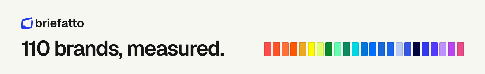
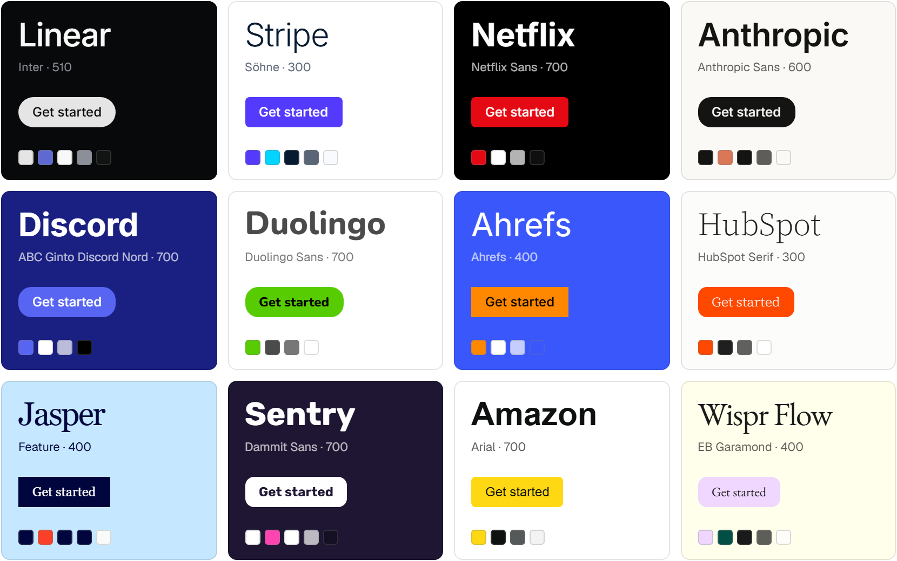

<p align="center">
  <picture>
    <source media="(prefers-color-scheme: dark)" srcset=".github/assets/banner-dark.png">
    
  </picture>
</p>

<p>
  <a href="#the-files">
    <picture>
      <source media="(prefers-color-scheme: dark)" srcset=".github/assets/brands-dark.png">
      
    </picture>
  </a>
</p>

<sub>Drawn from each brand's tokens: background, display weight, primary button, radius and palette.</sub>

`DESIGN.md` files for 110 brands, each measured from the brand's rendered public site and checked with Google's DESIGN.md linter. Every agent reads them before visual work.

## Use a brand

```sh
curl -o DESIGN.md \
  https://raw.githubusercontent.com/Briefatto/design-md-gallery/main/brands/linear/DESIGN.md
```

Swap `linear` for any folder in [`brands/`](brands/). Or paste this into any agent:

```text
Download
https://raw.githubusercontent.com/Briefatto/design-md-gallery/main/brands/linear/DESIGN.md
and save it as DESIGN.md in the project root.
```

### Keep it true with Briefatto Board

[Briefatto Board](https://github.com/Briefatto/briefatto-board) versions the guide and checks every piece your agent renders.

```sh
npx briefatto-board install
```

## What a file looks like

The colour tokens from [`brands/linear/DESIGN.md`](brands/linear/DESIGN.md):

```yaml
colors:
  primary: "rgb(229, 229, 230)"
  background: "rgb(8, 9, 10)"
  surface: "rgb(18, 20, 20)"
  foreground: "rgb(247, 248, 248)"
  muted: "rgb(138, 143, 152)"
  border: "rgb(46, 46, 50)"
  on-primary: "rgb(8, 9, 10)"
  accent: "rgb(94, 106, 210)"
```

And where they came from, in the same file:

> Built from [/](https://linear.app/) and [/pricing](https://linear.app/pricing), captured on 2026-11-21 UTC at 1440×900 and 390×844. The front matter holds the computed values as portable tokens.

## What every file carries

- **Tokens** in YAML front matter, to Google's DESIGN.md spec: colours, typography, radii, spacing and components.
- **Prose** an agent can act on: overview, colour roles, components, layout, voice, do's and don'ts.
- **Where it came from:** the pages and viewports it was measured from, and the capture date.
- **A preview** (`preview.png`) of the palette and type.

Each brand's guide on briefatto.com lists the page and viewport behind every colour and radius, and its Markdown version does the same for every spacing step.

Want your own brand instead? Run `npx briefatto-board adopt .` on your site and your agent writes yours.

## The files

Each brand also has a guide on briefatto.com: `briefatto.com/guides/<slug>-design-md/`.

| Brand | DESIGN.md | Source site |
| :--- | :--- | :--- |
| 10Web | [DESIGN.md](brands/10web/DESIGN.md) | 10web.io |
| 1Password | [DESIGN.md](brands/1password/DESIGN.md) | 1password.com |
| Abridge | [DESIGN.md](brands/abridge/DESIGN.md) | abridge.com |
| Ahrefs | [DESIGN.md](brands/ahrefs/DESIGN.md) | ahrefs.com |
| Airtable | [DESIGN.md](brands/airtable/DESIGN.md) | airtable.com |
| Algolia | [DESIGN.md](brands/algolia/DESIGN.md) | algolia.com |
| Amazon | [DESIGN.md](brands/amazon/DESIGN.md) | www.amazon.com |
| Animejs | [DESIGN.md](brands/animejs/DESIGN.md) | animejs.com |
| Annnimate | [DESIGN.md](brands/annnimate/DESIGN.md) | annnimate.com |
| Ant Design | [DESIGN.md](brands/ant-design/DESIGN.md) | ant.design |
| Anthropic | [DESIGN.md](brands/anthropic/DESIGN.md) | anthropic.com |
| Appwrite | [DESIGN.md](brands/appwrite/DESIGN.md) | appwrite.io |
| Asana | [DESIGN.md](brands/asana/DESIGN.md) | asana.com |
| Astral | [DESIGN.md](brands/astral/DESIGN.md) | astral.sh |
| Astro | [DESIGN.md](brands/astro/DESIGN.md) | astro.build |
| Attio | [DESIGN.md](brands/attio/DESIGN.md) | attio.com |
| Audi | [DESIGN.md](brands/audi/DESIGN.md) | www.audi.com/en |
| Avenue | [DESIGN.md](brands/avenue/DESIGN.md) | avenue.app |
| Base44 | [DESIGN.md](brands/base44/DESIGN.md) | base44.com |
| beehiiv | [DESIGN.md](brands/beehiiv/DESIGN.md) | www.beehiiv.com |
| Biome | [DESIGN.md](brands/biome/DESIGN.md) | biomejs.dev |
| Bulma | [DESIGN.md](brands/bulma/DESIGN.md) | bulma.io |
| Bun | [DESIGN.md](brands/bun/DESIGN.md) | bun.sh |
| Calendly | [DESIGN.md](brands/calendly/DESIGN.md) | calendly.com |
| Chromatic | [DESIGN.md](brands/chromatic/DESIGN.md) | chromatic.com |
| Circle | [DESIGN.md](brands/circle/DESIGN.md) | circle.so |
| Clay | [DESIGN.md](brands/clay/DESIGN.md) | clay.com |
| Clerk | [DESIGN.md](brands/clerk/DESIGN.md) | clerk.com |
| ClickUp | [DESIGN.md](brands/clickup/DESIGN.md) | clickup.com |
| Cline | [DESIGN.md](brands/cline/DESIGN.md) | cline.bot |
| Cloudflare | [DESIGN.md](brands/cloudflare/DESIGN.md) | www.cloudflare.com |
| Cohere | [DESIGN.md](brands/cohere/DESIGN.md) | cohere.com |
| Copilot | [DESIGN.md](brands/copilot/DESIGN.md) | copilot.app |
| Craft | [DESIGN.md](brands/craft/DESIGN.md) | www.craft.do |
| CTS Network | [DESIGN.md](brands/cts-network/DESIGN.md) | ctsnetwork.id |
| Datadog | [DESIGN.md](brands/datadog/DESIGN.md) | www.datadoghq.com |
| Deno | [DESIGN.md](brands/deno/DESIGN.md) | deno.com |
| DevInsight | [DESIGN.md](brands/devinsight/DESIGN.md) | devinsight.ai |
| Discord | [DESIGN.md](brands/discord/DESIGN.md) | discord.com |
| Dribbble | [DESIGN.md](brands/dribbble/DESIGN.md) | dribbble.com |
| Dropbox | [DESIGN.md](brands/dropbox/DESIGN.md) | dropbox.com |
| Duolingo | [DESIGN.md](brands/duolingo/DESIGN.md) | www.duolingo.com |
| ElevenLabs | [DESIGN.md](brands/elevenlabs/DESIGN.md) | elevenlabs.io |
| Figma | [DESIGN.md](brands/figma/DESIGN.md) | figma.com |
| Fin | [DESIGN.md](brands/fin/DESIGN.md) | fin.ai |
| Firebase | [DESIGN.md](brands/firebase/DESIGN.md) | firebase.google.com |
| Firecrawl | [DESIGN.md](brands/firecrawl/DESIGN.md) | www.firecrawl.dev |
| Framer | [DESIGN.md](brands/framer/DESIGN.md) | framer.com |
| Gemini CLI | [DESIGN.md](brands/gemini-cli/DESIGN.md) | geminicli.com |
| Ghost | [DESIGN.md](brands/ghost/DESIGN.md) | ghost.org |
| GitHub | [DESIGN.md](brands/github/DESIGN.md) | github.com |
| Glean | [DESIGN.md](brands/glean/DESIGN.md) | glean.com |
| Google | [DESIGN.md](brands/google/DESIGN.md) | about.google |
| Grammarly | [DESIGN.md](brands/grammarly/DESIGN.md) | grammarly.com |
| Granola | [DESIGN.md](brands/granola/DESIGN.md) | granola.ai |
| HeyGen | [DESIGN.md](brands/heygen/DESIGN.md) | heygen.com |
| HubSpot | [DESIGN.md](brands/hubspot/DESIGN.md) | hubspot.com |
| Hugging Face | [DESIGN.md](brands/hugging-face/DESIGN.md) | huggingface.co |
| Hypergryph | [DESIGN.md](brands/hypergryph/DESIGN.md) | www.hypergryph.com |
| Intercom | [DESIGN.md](brands/intercom/DESIGN.md) | intercom.com |
| Jasper | [DESIGN.md](brands/jasper/DESIGN.md) | jasper.ai |
| Linear | [DESIGN.md](brands/linear/DESIGN.md) | linear.app |
| Loom | [DESIGN.md](brands/loom/DESIGN.md) | loom.com |
| Lovart | [DESIGN.md](brands/lovart/DESIGN.md) | www.lovart.ai |
| Mailchimp | [DESIGN.md](brands/mailchimp/DESIGN.md) | mailchimp.com |
| Mintlify | [DESIGN.md](brands/mintlify/DESIGN.md) | mintlify.com |
| Miro | [DESIGN.md](brands/miro/DESIGN.md) | miro.com |
| Mistral AI | [DESIGN.md](brands/mistral-ai/DESIGN.md) | mistral.ai |
| Mixpanel | [DESIGN.md](brands/mixpanel/DESIGN.md) | mixpanel.com |
| Modal | [DESIGN.md](brands/modal/DESIGN.md) | modal.com |
| Monday.com | [DESIGN.md](brands/monday-com/DESIGN.md) | monday.com |
| NASA | [DESIGN.md](brands/nasa/DESIGN.md) | www.nasa.gov |
| Neon | [DESIGN.md](brands/neon/DESIGN.md) | neon.com |
| Netflix | [DESIGN.md](brands/netflix/DESIGN.md) | www.netflix.com |
| Nothing | [DESIGN.md](brands/nothing/DESIGN.md) | nothing.tech |
| Notion | [DESIGN.md](brands/notion/DESIGN.md) | notion.com |
| OpenClaw | [DESIGN.md](brands/openclaw/DESIGN.md) | openclaw.ai |
| Otter.ai | [DESIGN.md](brands/otter-ai/DESIGN.md) | otter.ai |
| Palantir | [DESIGN.md](brands/palantir/DESIGN.md) | www.palantir.com |
| Perplexity | [DESIGN.md](brands/perplexity/DESIGN.md) | www.perplexity.ai |
| Porsche | [DESIGN.md](brands/porsche/DESIGN.md) | www.porsche.com/usa |
| Prisma | [DESIGN.md](brands/prisma/DESIGN.md) | prisma.io |
| Proton | [DESIGN.md](brands/proton/DESIGN.md) | proton.me |
| Railway | [DESIGN.md](brands/railway/DESIGN.md) | railway.com |
| Ramp | [DESIGN.md](brands/ramp/DESIGN.md) | ramp.com |
| Resend | [DESIGN.md](brands/resend/DESIGN.md) | resend.com |
| Runway | [DESIGN.md](brands/runway/DESIGN.md) | runwayml.com |
| Samsung | [DESIGN.md](brands/samsung/DESIGN.md) | www.samsung.com/us |
| Sarvam AI | [DESIGN.md](brands/sarvam-ai/DESIGN.md) | www.sarvam.ai |
| Scale AI | [DESIGN.md](brands/scale-ai/DESIGN.md) | scale.com |
| Semrush | [DESIGN.md](brands/semrush/DESIGN.md) | www.semrush.com |
| Sentry | [DESIGN.md](brands/sentry/DESIGN.md) | sentry.io |
| Shopify | [DESIGN.md](brands/shopify/DESIGN.md) | shopify.com |
| Sierra | [DESIGN.md](brands/sierra/DESIGN.md) | sierra.ai |
| Slack | [DESIGN.md](brands/slack/DESIGN.md) | slack.com |
| Stripe | [DESIGN.md](brands/stripe/DESIGN.md) | stripe.com |
| Supabase | [DESIGN.md](brands/supabase/DESIGN.md) | supabase.com |
| Synthesia | [DESIGN.md](brands/synthesia/DESIGN.md) | synthesia.io |
| Tailwind CSS | [DESIGN.md](brands/tailwind-css/DESIGN.md) | tailwindcss.com |
| Toss | [DESIGN.md](brands/toss/DESIGN.md) | toss.im |
| Twilio | [DESIGN.md](brands/twilio/DESIGN.md) | twilio.com |
| Ubiquiti | [DESIGN.md](brands/ubiquiti/DESIGN.md) | ui.com |
| v0 | [DESIGN.md](brands/v0/DESIGN.md) | v0.app |
| Vercel | [DESIGN.md](brands/vercel/DESIGN.md) | vercel.com |
| Webflow | [DESIGN.md](brands/webflow/DESIGN.md) | webflow.com |
| WhatsApp | [DESIGN.md](brands/whatsapp/DESIGN.md) | www.whatsapp.com |
| Wispr Flow | [DESIGN.md](brands/wispr-flow/DESIGN.md) | wisprflow.ai |
| Zapier | [DESIGN.md](brands/zapier/DESIGN.md) | zapier.com |
| Zed | [DESIGN.md](brands/zed/DESIGN.md) | zed.dev |
| Zoom | [DESIGN.md](brands/zoom/DESIGN.md) | zoom.com |

## License

MIT. Brand names are trademarks of their owners; these style files are not affiliated with or endorsed by them.
